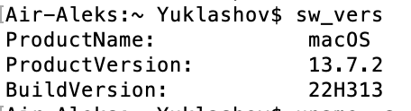
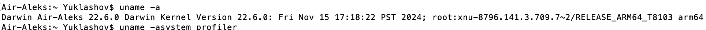
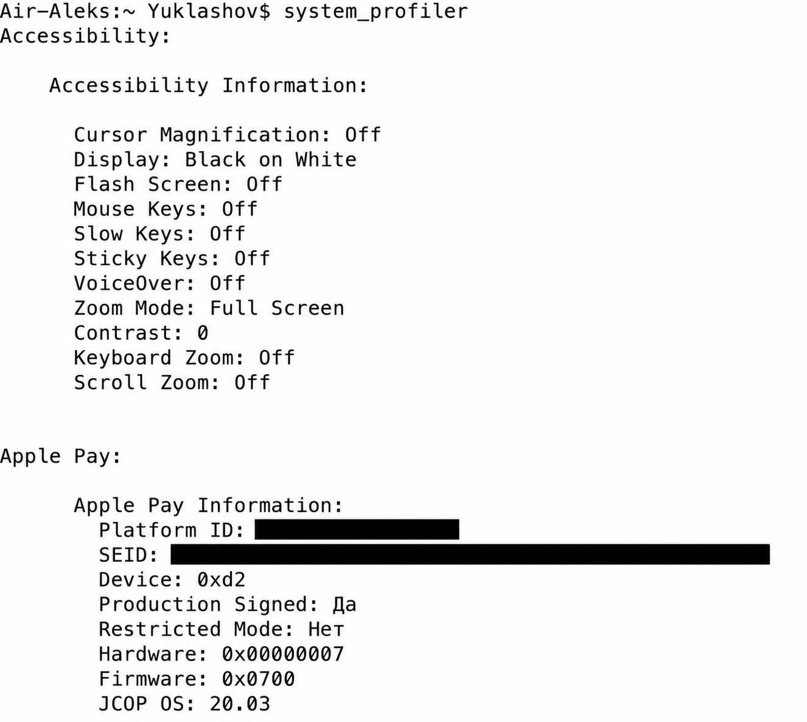
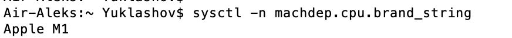
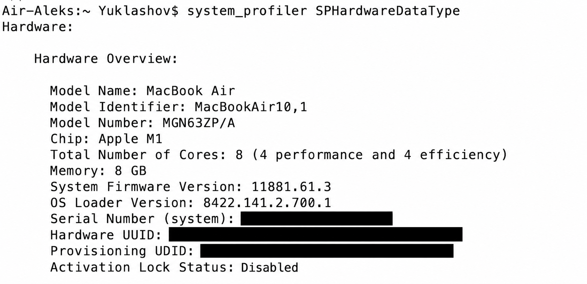

# Архитектура компьютера и операционная система

[Google Doc для передачи на платформу](https://docs.google.com/document/d/1HEJJ16JwoERkH6Nei-KabIyUabRMTF-SN8y_SQaIav8/edit?usp=drivesdk) — все пять исходных снимков с пояснениями, просмотр по ссылке включён.

Александр Юклашов · SYS-62 · вариант для macOS · 26 октября 2026 года.

[Текущее задание](https://netology.ru/profile/program/slina-62/lessons/607938/lesson_items/3273429) · [публичное условие](https://github.com/netology-code/slin-homeworks/blob/slin-22/1-01.md).

Выполнены пять команд на MacBook Air с Apple M1. Ниже приведены результаты и пояснения. Полные выводы system_profiler содержат идентификаторы устройства, поэтому в отчёте сохранены только сведения об ОС и оборудовании.

## 1. sw_vers

Показывает название macOS, версию продукта и номер сборки. В текущем выводе установлена macOS 26.6.2, сборка 25G83.

```text
$ sw_vers
ProductName:		macOS
ProductVersion:		26.6.2
BuildVersion:		25G83
```

[Текстовый результат](evidence/01-sw-vers.txt)

## 2. uname -a

Показывает сведения о ядре: имя Darwin, его версию, сведения о сборке и архитектуру. Darwin 25.6.0 и arm64 относятся к ядру и архитектуре; это другой номер версии, чем macOS 26.6.2. Имя компьютера заменено на [hostname].

```text
$ uname -a
Darwin [hostname] 25.6.0 Darwin Kernel Version 25.6.0: Fri Jul 31 19:17:12 PDT 2026; root:xnu-12377.161.14~5/RELEASE_ARM64_T8103 arm64
```

[Текстовый результат](evidence/02-uname.txt)

## 3. system_profiler

Собирает подробный отчёт об оборудовании и программном обеспечении. Из полного вывода оставлены разделы Hardware и Software: модель MacBook Air, Apple M1, 8 ядер CPU, 8 GB памяти и версия ОС. Ограничение вывода сделано после выполнения команды; системные настройки не изменялись.

```text
$ system_profiler
      Model Name: MacBook Air
      Model Identifier: MacBookAir10,1
      Model Number: MGN63ZP/A
      Chip: Apple M1
      Total Number of Cores: 8 (4 Performance and 4 Efficiency)
      Memory: 8 GB
      System Firmware Version: 18000.161.10
      OS Loader Version: 18000.161.10
      System Version: macOS 26.6.2 (25G83)
      Kernel Version: Darwin 25.6.0
      Boot Mode: Normal

[Only OS and hardware fields retained; private identifiers omitted.]
```

[Текстовый результат](evidence/03-system-profiler.txt)

## 4. sysctl -n machdep.cpu.brand_string

Читает параметр системы с названием процессора. Флаг -n оставляет только значение параметра. На этом компьютере команда вернула Apple M1.

```text
$ sysctl -n machdep.cpu.brand_string
Apple M1
```

[Текстовый результат](evidence/04-cpu.txt)

## 5. system_profiler SPHardwareDataType

Запрашивает аппаратный раздел system_profiler. Здесь указаны модель компьютера, идентификатор модели, процессор, число ядер, память и версии прошивок. Данная команда отличается от system_profiler тем, что сразу ограничивает сбор сведений аппаратным разделом.

```text
$ system_profiler SPHardwareDataType
      Model Name: MacBook Air
      Model Identifier: MacBookAir10,1
      Model Number: MGN63ZP/A
      Chip: Apple M1
      Total Number of Cores: 8 (4 Performance and 4 Efficiency)
      Memory: 8 GB
      System Firmware Version: 18000.161.10
      OS Loader Version: 18000.161.10

[Only OS and hardware fields retained; private identifiers omitted.]
```

[Текстовый результат](evidence/05-hardware.txt)

## Скриншоты прежнего выполнения

Пять исходных снимков найдены в Google Диске: выполнение от 21 октября 2025 года. На них macOS 13.7.2. Они используются как доказательства прежнего выполнения; в условии нет требования о новых снимках. Две копии обработаны imagegen только для скрытия идентификаторов, видимый технический текст сверен. Новый запуск 26 октября подтверждён отдельными текстовыми результатами выше.











## Воспроизведение

Скрипт запускается на macOS и сохраняет результаты пяти команд. Он исключает серийные номера, UUID и другие персональные идентификаторы из сохраняемого вывода.

```bash
python3 scripts/collect_system_info.py
```

## Готовность

- [x] Условие текущего потока прочитано.
- [x] Все пять команд выполнены; коды завершения — 0.
- [x] Результаты объяснены и сохранены.
- [x] Старые скриншоты отделены от нового выполнения.
- [x] Все пять исходных снимков добавлены; новые снимки условием не требуются.
- [x] Google Doc создан, конвертация и все три страницы проверены; открыт режим чтения по ссылке.
- [ ] Отправить ссылку в кабинете: на странице сейчас отсутствует поле ответа.

Работа самостоятельная, эксперт её не проверяет. Существующий зачёт первого модуля не заменяет отдельный статус этой практики.
