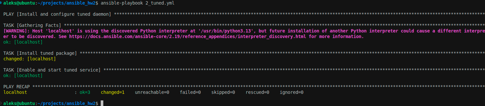
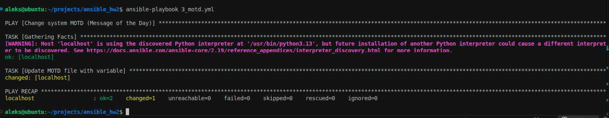
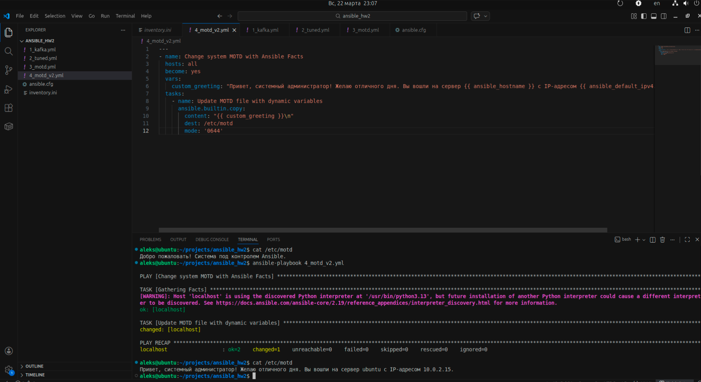
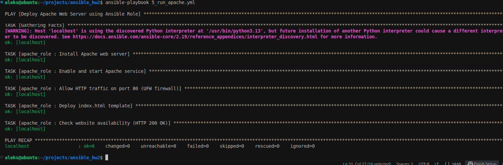
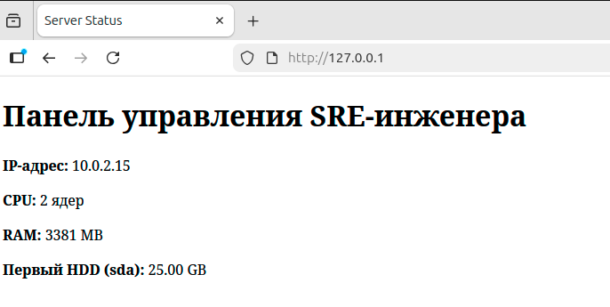
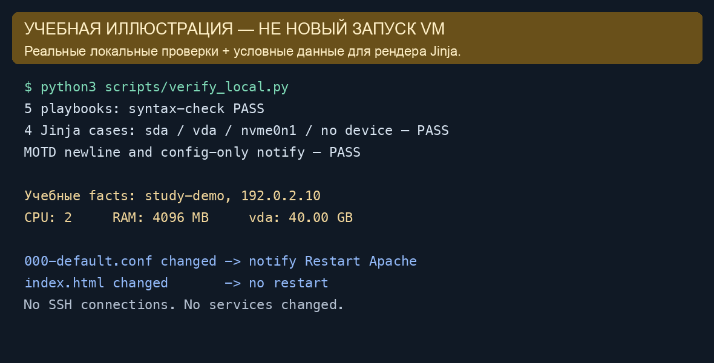

# Ansible. Часть 2 — Александр Юклашов

**Выполнено самостоятельно в локальном режиме, 27 октября 2026 года.** Первая работа из текущей очереди 14 практик.

[Условие](Задание.md) · [Код](src/) · [Команды](scripts/Команды.md) · [Статус](Статус_SYS-62.md) · [История](Мануал.md).

Переиспользованы [Google Doc от марта 2026 года](https://docs.google.com/document/d/1GmTbB11NnTkNcEgB9Ap91mE7dL0seEd6joRFhbjfO2I/edit), локальный DOCX, архив `apache_role.tar.gz` и семь настоящих исторических изображений. Исправлены только найденные пробелы. VM, SSH, установка пакетов и новый Linux-прогон не выполнялись. Отправка и commit/push не выполнялись по договорённости для самостоятельных.

## Задание 1. Три плейбука

| Файл | Решение |
|---|---|
| [1_kafka.yml](src/1_kafka.yml) | file создаёт каталог; get_url скачивает архив; unarchive распаковывает уже скачанный файл с remote_src=true |
| [2_tuned.yml](src/2_tuned.yml) | apt устанавливает tuned, systemd_service задаёт started и enabled |
| [3_motd.yml](src/3_motd.yml) | copy записывает custom_greeting в /etc/motd с завершающим переводом строки |

Kafka 3.6.1 сохранена как версия учебного архива из старого решения; это не рекомендация текущей версии Kafka. Каталог `/opt/kafka/3.6.1` отделяет версии, `creates` предотвращает повторную распаковку уже подготовленной версии. Запуск брокера в условие не входит. [Документация unarchive](https://docs.ansible.com/ansible/latest/collections/ansible/builtin/unarchive_module.html).

Плейбуки рассчитаны на Debian/Ubuntu с systemd. Исторические кадры подтверждают установку tuned и изменение MOTD:

На кадре tuned: ok=3, changed=1, failed=0. На кадре MOTD: ok=2, changed=1, failed=0. Отдельного сохранённого вывода распаковки Kafka нет. Сейчас все три плейбука прошли локальный syntax-check, что не заменяет подтверждение их выполнения на Linux.

## Задание 2. MOTD с фактами

[4_motd_v2.yml](src/4_motd_v2.yml) формирует приветствие из переменной с `ansible_facts['hostname']` и `ansible_facts.default_ipv4.address`, сохраняя пожелание хорошего дня. Явный `ansible_facts` не зависит от включённой подстановки фактов в переменные верхнего уровня. Если адрес не собран, выводится «IP не определён», а не выдуманный адрес. [Ansible facts](https://docs.ansible.com/ansible/latest/playbook_guide/playbooks_vars_facts.html).

Кадр показывает прежний hostname и адрес локальной VM после изменения файла. Эти значения не относятся к текущему облачному стенду; новая VM не создавалась.

## Задание 3. Роль Apache

[5_run_apache.yml](src/5_run_apache.yml) использует одну [роль apache_role](src/roles/apache_role/README.md). Проверенный архив — [apache_role-reviewed.tar.gz](apache_role-reviewed.tar.gz); исходный мартовский архив сохранён рядом без изменения.

| Требование | Где реализовано |
|---|---|
| Apache установлен, запущен и в автозагрузке | [tasks/main.yml](src/roles/apache_role/tasks/main.yml): apt и systemd_service |
| CPU, RAM, диск и IP на странице | [index.html.j2](src/roles/apache_role/templates/index.html.j2), данные ansible_facts |
| Перезапуск только при смене конфигурации | [000-default.conf.j2](src/roles/apache_role/templates/000-default.conf.j2) уведомляет [handler](src/roles/apache_role/handlers/main.yml); HTML его не уведомляет |
| Порт 80 при необходимости | community.general.ufw при apache_manage_ufw=true; по умолчанию false |
| HTTP 200 | uri к 127.0.0.1 на управляемом хосте, после flush_handlers |
| Запрет shell/command | Эти модули не используются |

Главная доработка: старый notify стоял на index.html. Теперь notify принадлежит конфигурации виртуального хоста Apache; смена статического HTML не вызывает перезапуск. Это соответствует условию и механизму handlers. [Документация handlers](https://docs.ansible.com/ansible/latest/playbook_guide/playbooks_handlers.html).

Дополнительно исправлены жёсткая привязка к `sda` и скрытие ошибок UFW через ignore_errors. По умолчанию выбирается первый по имени диск без loop/ram/sr/dm; для нужного физического устройства можно явно задать `apache_disk_name`. Проверены sda, vda, nvme0n1 и отсутствие данных о дисках. Правило UFW включается только отдельным параметром; роль не меняет сетевые правила облака.

Вывод из статьи: плейбук описывает желаемое состояние через специализированные модули, факты и шаблоны; постоянная замена задач командами оболочки усложняет повторяемость и учёт изменений. Здесь использованы file/get_url/unarchive, apt, copy/template, systemd_service и uri. [Статья из задания](https://habr.com/ru/articles/494738/).

Эти кадры подтверждают прежнюю роль: повторный запуск с ok=6, changed=0, failed=0 и страницу с CPU/RAM/диском/IP. Они **не подтверждают** новый вариант handler после исправления. Исправленный код проверен локально, на Linux заново не применялся.

## Локальные проверки и учебный пример

- Установленный на Mac Ansible core 2.20.4 выполнил `--syntax-check` для всех пяти плейбуков: к хостам этот режим не подключается.
- YAML прочитан, запрещённые модули отсутствуют, единственный notify находится на конфигурации Apache.
- Jinja-шаблон отрендерен с четырьмя наборами условных facts; отсутствующий диск не вызывает ошибку. Проверен завершающий перевод строки MOTD.
- Результаты: [local-checks.json](evidence/local-checks.json); повторяемая проверка: [verify_local.py](scripts/verify_local.py).

[HTML-пример](examples/apache-demo.html) получен локальным рендером с условными facts и содержит явную подпись «не страница реальной VM». Нарисованный экран выше иллюстрирует эти проверки, не вывод развёртывания Ansible.

Происхождение и SHA256 всех семи исходных снимков — в [manifest.json](evidence/manifest.json). Скриншоты относятся к марту 2026 года, не к текущему выполнению. В нашей базе все три пункта завершены в согласованном локальном режиме; официальный статус, отправка и экспертный зачёт не повышались.
