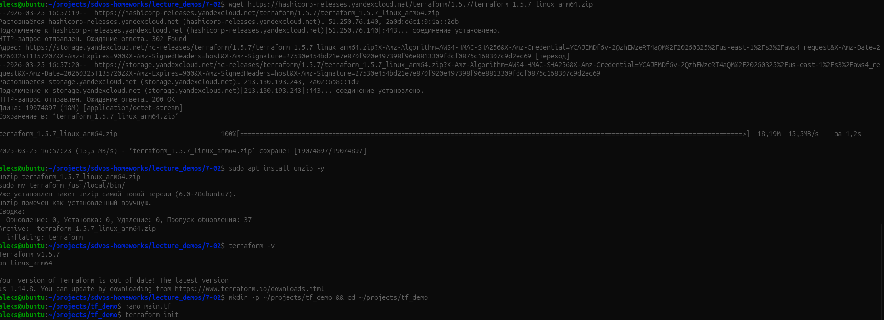
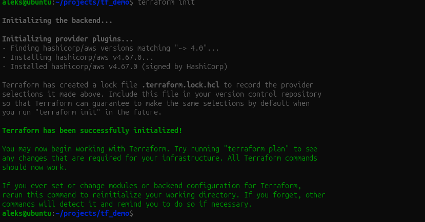

# Terraform — выполнено самостоятельно

## 1. Установка

Переиспользован архив марта 2026: установлен Terraform 1.5.7 для Linux ARM64, команда `terraform -v` успешна. Исходный снимок ниже — прежнее выполнение, не новый запуск.

На текущем Mac Terraform уже установлен: 1.14.9, darwin_arm64. Повторная установка не потребовалась. Архивную 1.5.7 не предлагаем как актуальную версию.

## 2. Повторение демонстрации

Архив подтверждает `terraform init`: выбран `hashicorp/aws` 4.67.0 по ограничению `~> 4.0`, инициализация успешна. Создание инфраструктуры и `apply` этот кадр не подтверждает.

В [src/provider-example/main.tf](src/provider-example/main.tf) восстановлен минимальный пример провайдера по кадру. Точного исходного файла в архиве нет. [src/main.tf](src/main.tf) дополнительно показывает переменную, выражение, ресурс и output без облачного провайдера: встроенный `terraform_data` хранит учебные данные в state. Локально проверены форматирование, `init -backend=false`, `validate` и `plan` во временной копии. `apply` не запускался.

`init` подготавливает backend/провайдеры, `plan` рассчитывает изменения, `apply` применяет их, `destroy` удаляет управляемые ресурсы. State связывает конфигурацию с объектами; его и секретные tfvars не публикуют. Lock-файл провайдеров обычно версионируют.

## Материалы и факты

[Команды](scripts/Команды.md), [локальная проверка](evidence/local-checks.txt), [условие](Задание.md), [история](Мануал.md), [статус](Статус_SYS-62.md).

Проверены локальный DOCX, [Google-оригинал](https://docs.google.com/document/d/1JAfFDvpfo55x7qeoOD790An8UtFFsuoqS9HXa_pV5zo/edit) (состоит из изображений; текстовый экспорт пуст) и дерево GitHub study/sys-62-restart (только прежняя карточка). Исходный DOCX сохранён. VM не использовались, решение не отправлялось, зачёт не заявлен.

Отдельный тест 3523473 сдан в кабинете 27 октября: **5 из 5**, первая попытка. [Подтверждение](evidence/test-passed-2026-10-27.png).
