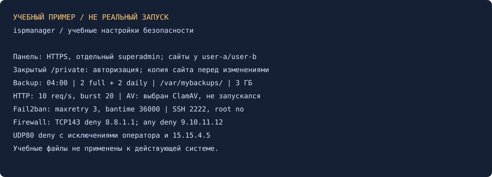

# Настройка инструментов безопасности — Александр Юклашов

Выполнено самостоятельно 27 октября 2026: ответы по всем шагам, конфигурации, таблица правил и учебная иллюстрация. Реальный ispmanager, SSH, Fail2ban, антивирус и брандмауэр не настраивались.

## 1. Защита от DoS/DDoS

«Сайты → Изменить → Защита от DDoS» ограничивает HTTP-запросы на уровне веб-сервера. Для одиночного источника пригодны rate limit, ограничения соединений, Fail2ban и IP-фильтр. Для распределённого HTTP-флуда нужны фильтрация/челленджи на внешнем reverse proxy, например интеграция DDoS-Guard. Объёмную атаку, забившую канал, локальная панель не остановит: требуется защита у провайдера. WAF ModSecurity помогает от вредоносных HTTP-запросов, антивирус — от вредоносных файлов; ни один из них не заменяет очистку входящего канала.

## 2–8. Панель, сайты и копии

| Шаг | Подготовленная настройка | Проверка при реальном запуске |
|---|---|---|
| 2 | HTTPS с доверенным сертификатом, ограниченный доступ к панели, отдельный superadmin, уникальный пароль root/2FA панели, обновления | Меню «Настройки системы»/root; вход и журнал |
| 3 | a.example.test у user-a, b.example.test у user-b | Разные владельцы, docroot и доступ к файлам |
| 4 | /private/index.html у a, парольная защита каталога через панель | Без авторизации 401/403, с разрешённым аккаунтом 200 |
| 5 | Отдельная копия a через «Сайты» | Завершённая копия в «Восстановление сайта», пробное восстановление |
| 6 | /var/mybackups/, 04:00, хранить 2 полные и 2 ежедневные, лимит 3 ГБ | Настройки и расписание; свободное место, результаты заданий |
| 7 | HTTP rate 10 запросов/с, burst 20 для a | В форме именно лимит 10 и всплеск 20; поведение в журнале |
| 8 | Выбран ClamAV как разрешённая альтернатива Imunify | ПО установлено, базы обновлены, один файл проверен; результат не выдумывать |

Для расписания выбран полный бэкап раз в неделю в 04:00 и ежедневные в 04:00 в остальные дни, ограничения хранения — из условия. Если 3 ГБ не вмещают нужную цепочку, задания резервирования потребуют места/пересмотра размера; нельзя считать число копий гарантированным лишь из формы. Копия на том же диске не защищает от потери сервера: внешнее хранилище желательно отдельно.

[Учебная HTML-страница](src/private-index.html) не содержит секрета. Парольную защиту задавать через панель, пароль не включать в репозиторий.

## 9–12. Fail2ban, администратор и SSH

Глобально: `maxretry=3`, `bantime=36000` (10 часов), свой /32 в ignoreip; окно `findtime=600` выбрано для примера, условие его не задаёт. [Конфигурация](src/fail2ban-example.local) включает Exim, Dovecot, FTP и SSH; порт SSH 2222 совпадает с [sshd-фрагментом](src/sshd-example.conf). Имена фильтров и журналы зависят от установленного ПО — сверить перед применением.

Шаг 10: отдельный superadmin панели. Для шага 11 дополнительно нужен настоящий Linux-администратор `labadmin` с ключом и sudo: учётная запись панели сама по себе не подтверждает sudo-доступ. Сначала проверить его SSH и sudo, разрешить новый порт в SG/файрволе для оператора, проверить `sshd -t`, открыть вторую сессию. После успешного входа запретить root и старый порт. Изменение порта уменьшает шум, но основную защиту дают ключи, запрет root и ограничение источника. Порядок предотвращает потерю доступа.

## 13. Брандмауэр и зависимые правила

| Порядок | Источник | Протокол/порт | Решение |
|---|---|---|---|
| 1 | IP оператора /32 | Любые | Разрешить |
| 2 | 9.10.11.12 | Любые | Запретить |
| 3 | 8.8.1.1 | TCP/143 | Запретить |
| 4 | 15.15.4.5 | UDP/80 | Разрешить как исключение |
| 5 | Все остальные | UDP/80 | Запретить |

В панели общее правило UDP/80 связывается с исключениями оператора и 15.15.4.5. Разрешения должны срабатывать до общего запрета. TCP/80 эта UDP-группа не запрещает; запрет TCP/143 не относится к UDP/143. IP из условия — только спецификация, никакой трафик на них не отправлялся. В [JSON-модели](src/firewall-policy.json) вместо реального IP оператора используется документальный 192.0.2.10. Остальные разрешения сервера находятся за пределами этих четырёх требований; это не полный firewall ruleset.

## 14. Самопроверка

Все значения и этапы 1–13 оформлены. Парсер прочитал INI/JSON/HTML; проверка модели покрывает исключения и различие TCP/UDP. [Результат](evidence/local-checks.txt). Реального сканирования, блокировок и снимков установленной панели нет; учебная схема это прямо указывает.

[Условие](Задание.md), [команды](scripts/Команды.md), [история](Мануал.md). Старое решение искали локально, в Google ДЗ/архиве и GitHub; найден только каркас. Отправки, VM, покупок модулей и официального зачёта нет.

Источники: [защита DDoS](https://www.ispmanager.ru/docs/ispmanager/nastrojka-zashhity-ot-ddos-atak), [правила файрвола](https://www.ispmanager.ru/docs/ispmanager/nastrojka-pravil-fajrvola), [Fail2ban](https://github.com/fail2ban/fail2ban/blob/master/config/jail.conf), [ClamAV](https://docs.clamav.net/manual/Usage/Scanning.html).
