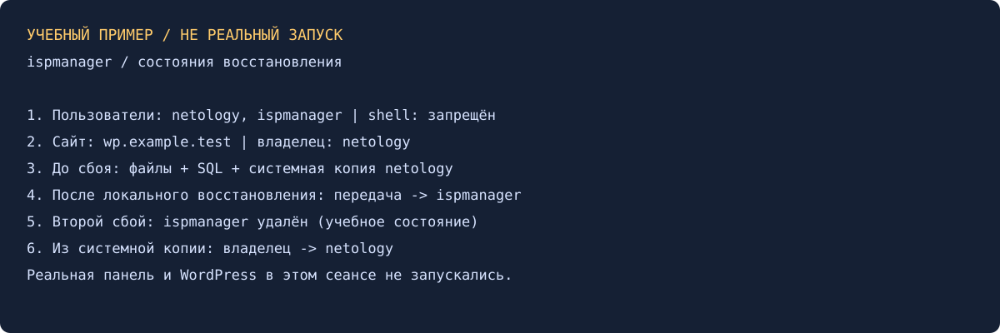

# Данные и резервное копирование ispmanager — Александр Юклашов

Выполнено самостоятельно 27 октября 2026 в локальном режиме. Описаны оба сценария, подготовлен учебный экран и выполнена отдельная модель восстановления на Mac. Панель/WordPress/MySQL не запускались.

## Подготовка и копии

В панели предполагаются пользователи `netology` и `ispmanager`: автоматическое создание объектов выключено, все доступы включены кроме shell. На `netology` создаётся WordPress `wp.example.test`, проверяются сайт и БД. Пароли WordPress/БД сохраняются отдельно от отчёта.

До любого учебного удаления нужны две независимые формы восстановления: скачать каталог сайта из www/ и SQL-дамп его БД; затем создать системную копию с данными пользователей и убедиться, что задание завершилось успешно. Проверить состав и читаемость копии, а не только наличие строки «создаётся».

| Шаг | Действие в панели | Что проверять |
|---|---|---|
| 1 | Создать двух пользователей | Имена netology/ispmanager, shell выключен, автообъекты выключены |
| 2 | WordPress у netology | Сайт и БД существуют, главная и админка доступны |
| 3 | Скачать файлы + экспорт SQL | Архив раскрывается, дамп непустой, записаны имя БД/пользователь |
| 4 | Системная резервная копия | Данные netology включены, копия закончена без ошибок |
| 5 | Учебный сбой №1 | Удалены файлы внутри каталога сайта и его БД; сайт не работает |
| 6 | Восстановление из скачанного | Правильный docroot, создана БД прежнего имени, импортирован SQL |
| 7 | Передать сайт ispmanager | Новый владелец, связанные БД/файлы/права согласованы, сайт работает |
| 8 | Учебный сбой №2 | Удалён только учебный ispmanager с ресурсами, сайт исчез |
| 9 | Системное восстановление | Выбрана исходная копия netology до переноса, сайт снова у netology |
| 10 | Итоговая проверка | Главная/админка/изображения/БД, владелец и ошибки журнала |

## Восстановление из файлов и SQL

Архив распаковывается в `/var/www/netology/data/www/wp.example.test/` без лишнего вложенного каталога. Воссоздаются имя БД, учётная запись и права, которые ожидает wp-config.php; импортируется SQL. Если имя/пароль изменены, корректируется конфигурация сайта. Не размещать SQL-дамп в публичном docroot. Сравнить файлы по SHA256 и содержимое страниц/БД. Проверка только HTTP/200 недостаточна: страница ошибки тоже может возвращать 200.

Перенос делать механизмом панели «Перенос данных между пользователями», включая зависимости сайта и БД. Одного chown недостаточно: панель продолжит считать владельцем прежнего пользователя. После удаления второго владельца восстановить исходную копию netology и проверить пути/права/БД/DNS, не оставляя конфликтующих объектов.

## Учебный результат

[scripts/model_restore.py](scripts/model_restore.py) работает только во временной папке: создаёт сайт-заглушку и SQLite, сохраняет архив/SQL/полную копию, моделирует оба сбоя и сравнивает восстановленные файлы и SQL-запись. Это демонстрация принципа, а не запуск WordPress и не экспорт резервной копии ispmanager. Реальный результат модели: [JSON](evidence/model-result.json).

[Условие](Задание.md), [команды](scripts/Команды.md), [история](Мануал.md). Старый отчёт не найден в локальных материалах, учебном Google Диске и GitHub; переиспользовать было нечего. Новая VM, отправка и официальный зачёт отсутствуют.

Источники: [резервные копии](https://www.ispmanager.ru/docs/ispmanager/rezervnye-kopii), [перенос данных между пользователями](https://www.ispmanager.ru/docs/ispmanager/perenos-dannyh-mezhdu-polzovatelyami).
