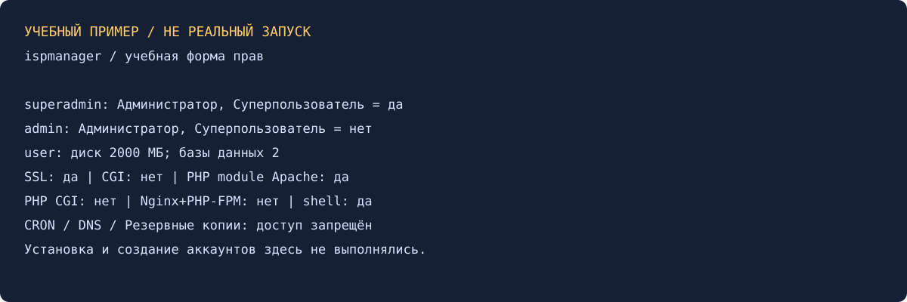

# Установка ispmanager — Александр Юклашов

Выполнено самостоятельно в согласованном локальном режиме 27 октября 2026. Подготовлены команды и полный набор настроек. Панель не установлена, аккаунты реально не создавались; экраны ниже — учебные примеры.

## Часть 1. Установка и базовая настройка

Выбран учебный вариант: чистая Debian 12 x86_64 Server, ветка stable, рекомендуемое ПО, Nginx + Apache (MPM-ITK), SQLite для служебной БД панели. SQLite панели не означает отсутствие отдельной MySQL/MariaDB для сайтов. До установки нужны hostname, время/NTP, проверка поддерживаемой ОС и свободных ресурсов. По официальной документации Debian 12 поддерживается.

[Команды](scripts/Команды.md) включают загрузку официального install.sh, просмотр и запуск с выбором пунктов. Для входа используется HTTPS/1500/ispmgr; первичная учётная запись root, далее отдельный superadmin. Сертификат должен быть проверен; пароль и ключ лицензии в отчёт не записываются. Лицензию/промокод в этой локальной практике не приобретали и не активировали.

После установки планируются hostname `panel.example.test`, часовой пояс Europe/Moscow, язык русский и стартовая страница. `.test` — учебное имя, не публичный домен и не реальный сервер.

## Часть 2. Три учётные записи

| Учётная запись | Уровень | Настройка |
|---|---|---|
| superadmin | Администратор с правами суперпользователя | «Администраторы → Создать», включить «Суперпользователь» |
| admin | Администратор | Та же форма, «Суперпользователь» выключен |
| user | Пользователь | «Пользователи → Создать», квоты и доступы по таблице ниже |

Отдельный superadmin создаётся дополнительно к встроенному root. Обычный администратор не равен root; пользователь управляет только своими объектами.

| Поле user | Требуемое значение |
|---|---|
| Диск | 2000 МБ |
| Базы данных | 2 |
| SSL | Разрешить |
| CGI | Запретить |
| PHP как модуль Apache | Разрешить |
| PHP CGI | Запретить |
| PHP FastCGI (Nginx + PHP-FPM) | Запретить |
| shell | Разрешить |
| Планировщик CRON | Доступ запрещён |
| Управление DNS | Доступ запрещён |
| Резервные копии | Доступ запрещён |

Для запретов функций: выбрать user → «Права», отключить наследование для CRON/DNS/резервных копий, запретить доступ с применением к подфункциям. Проверять входом под user: разделы недоступны также через API. Квота должна поддерживаться файловой системой и быть включена; одно заполненное поле не подтверждает работу дисковой квоты. Для PHP как модуля необходимы Apache ITK/Prefork и модуль PHP.

## Самопроверка

Сверить три роли и все 11 строк прав/лимитов; попытка третьей БД и превышение диска должны отклоняться, а разрешённые SSL/shell оставаться доступны. В учебной спецификации эти значения заполнены: [desired-settings.json](src/desired-settings.json). Фактические попытки в панели не проводились.

[Условие](Задание.md), [история](Мануал.md), [локальные проверки](evidence/local-checks.txt). Старый отчёт искали локально, в двух учебных папках Google Диска/архиве и дереве GitHub — найдены только карточки, готового решения нет. Отправка, экспертная проверка и официальный зачёт не заявлены.

Источники: [установка](https://www.ispmanager.ru/docs/ispmanager/ustanovka-ispmanager), [поддерживаемые ОС](https://www.ispmanager.ru/docs/ispmanager/sistemnye-trebovaniya-ispmanager), [пользователь и разрешения PHP](https://www.ispmanager.ru/docs/ispmanager/polzovatel), [ограничение функций](https://www.ispmanager.ru/docs/ispmanager/dostup-k-funkcziyam), [уровни доступа](https://www.ispmanager.ru/docs/ispmanager/urovni-dostupa).
