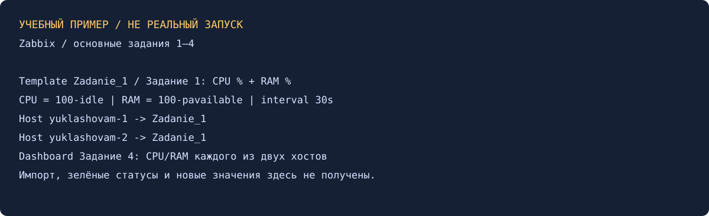

# Система мониторинга Zabbix. Часть 2 — Александр Юклашов

Выполнено самостоятельно 27 октября 2026: четыре основных пункта оформлены локально. Реального Zabbix/VM нет; шаблон подготовлен, импорт и сбор метрик не выполнялись.

## 1. Шаблон «Задание 1»

Техническое имя `Zadanie_1`, отображаемое «Задание 1», группа Templates/Custom. [YAML для импорта](src/Zadanie_1.yaml), формат 7.4, содержит два элемента и два графика.

| Метрика | Ключ агента | Преобразование | Тип/интервал |
|---|---|---|---|
| CPU usage, % | system.cpu.util[,idle] | 100 − idle | Float, %, 30s |
| RAM usage, % | vm.memory.size[pavailable] | 100 − available | Float, %, 30s |

CPU idle сначала измеряет простой, поэтому без преобразования показывалась бы обратная величина. RAM оценивается как недоступная память, учитывая пригодный к освобождению cache в available; это выбранное определение загрузки. Нулевой available означает 100%, не отсутствие данных. Ошибки/unsupported не преобразовывать в 0.

Импорт: Data collection → Templates → Import; проверить предпросмотр, группу и ровно эти два элемента. Встроенный Linux-шаблон с теми же ключами одновременно не привязывать, чтобы не получить дубликаты. Это подготовленный импорт, не экспорт из работающего сервера; серверная проверка формата пока не выполнялась.

## 2–3. Два хоста и привязка

`yuklashovam-1` и `yuklashovam-2` — фамилия и инициалы А.М. На агентах `Server` указывает частный адрес сервера, `Hostname` точно совпадает с именем в UI. [Фрагменты агентов](src/agent-1.conf.example) используют только документальные адреса.

В Hosts: Linux servers, Agent interface с адресом соответствующей VM:10050, Enabled, Templates → Zadanie_1. Для пассивных запросов TCP10050 открыт только серверу. Затем Latest data: оба CPU/RAM имеют свежий timestamp, единицы %, без unsupported. Зелёный интерфейс подтверждается фактическим опросом, а не нарисованной иконкой.

## 4. Дашборд «Задание 4»

Создать дашборд с точным названием, добавить четыре виджета Graph classic: CPU/RAM для каждого хоста. Выбрать графики шаблона, период час, оси 0–100%. [Спецификация](src/dashboard-spec.json). Так можно сравнить оба сервера, а не случайно показать одни и те же items дважды.

## Проверка и ограничения

YAML/JSON прочитаны локально, ключи/ссылки графиков согласованы; арифметика преобразования проверена на 0/20/100. [Результат](evidence/local-checks.txt). Зелёные статусы, Latest data и настоящий импорт не заявляются. Задания 5–9* (карта, Bash/Python UserParameter, discovery, Vagrant) необязательны и не выбраны.

Старое решение искали локально, в GitHub и учебном Google Диске; найдены только условие/карточки. [Текущее условие](Задание.md) взято именно из ветки `ne` по ссылке кабинета, а не подменено main. [История](Мануал.md), [команды](scripts/Команды.md). Без отправки, VM и commit/push; официальный зачёт не заявлен.

Источники: [элементы агента](https://www.zabbix.com/documentation/current/en/manual/config/items/itemtypes/zabbix_agent), [шаблоны](https://www.zabbix.com/documentation/current/en/manual/config/templates), [дашборды](https://www.zabbix.com/documentation/current/en/manual/config/visualization/dashboards).
