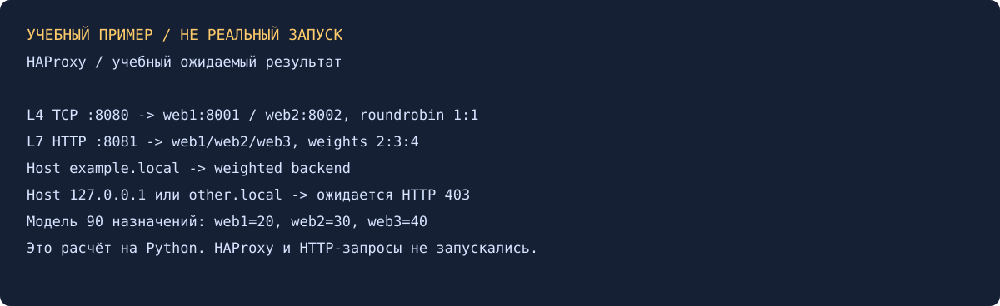

# Кластеризация и балансировка нагрузки — Александр Юклашов

Выполнено самостоятельно 27 октября 2026: две основные конфигурации, три страницы Python-backend, команды и подписанная иллюстрация. HAProxy/Nginx/VM не запускались; старого готового решения не найдено локально, в GitHub и учебном Google Диске.

## 1. Round-robin на L4

[src/haproxy-l4.cfg](src/haproxy-l4.cfg): `mode tcp`, frontend 127.0.0.1:8080, два backend на 8001/8002 с одинаковым весом и `balance roundrobin`. L4 выбирает сервер при новом TCP-соединении, не разбирает URL/Host. Несколько запросов по одному keep-alive-соединению могут оставаться на одном backend — это нормально.

Ожидаемая проверка: два `python3 -m http.server` с разными каталогами, затем серия **отдельных** curl к :8080. Ответы web1/web2 позволяют определить обслуживший backend. Проверки check подтверждают TCP-доступность, но не смысл HTTP-ответа.

## 2. Weighted round-robin на L7

[src/haproxy-l7.cfg](src/haproxy-l7.cfg): `mode http`, frontend :8081, веса web1=2, web2=3, web3=4. Из Host выделяется доменное имя без порта, приводится к нижнему регистру, сравнивается с `example.local`. Иной Host получает 403 до backend. Это различает запрос с правильным именем и обращение по IP. Для настоящего HTTPS нужна терминация TLS или другой механизм маршрутизации; данный пример — HTTP.

Ожидаемые доли на большой серии запросов при всех здоровых backend: 2/9, 3/9, 4/9. Небольшая серия, конкурентность, соединения и health checks могут менять порядок. Для одинаковых запросов при отсутствии сбоев соотношение сходится к весам. HTTP-check проверяет GET / и 200.

## Локальная проверка

[scripts/model.py](scripts/model.py) рассчитывает математическую последовательность: 20 назначений при 1:1 → 10/10, 90 при 2:3:4 → 20/30/40; проверяет четыре Host. [Результат](evidence/model-result.json). Это самостоятельная модель, а не проверка реализации HAProxy. На Mac бинарники HAProxy/Nginx не найдены, `haproxy -c` не выполнялся. Конфигурации просмотрены по официальному руководству.

[Условие](Задание.md), [команды запуска и curl](scripts/Команды.md), [история](Мануал.md). Задания 3–4* с Nginx/jpg и двумя доменами необязательны и не выбраны. Не делали отправку и commit/push, официальный зачёт не заявлен.

Источник: [руководство HAProxy 3.0](https://docs.haproxy.org/3.0/configuration.html), разделы mode/balance/server weight/ACL/http-request deny.
