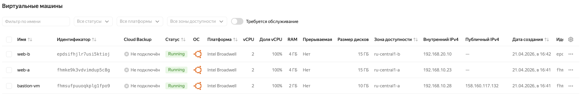
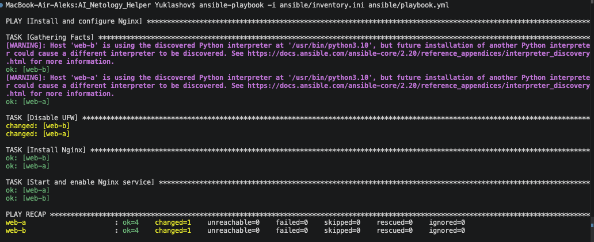

# 7.3. Подъём инфраструктуры в облаке — Юклашов

Выполнено самостоятельно 27 октября 2026: переиспользован существующий стендовый отчёт, подготовлен исправленный вариант кода. Новый облачный запуск не выполнялся.

## Задание 1. VPC, web-a/web-b и bastion

Сеть общая, подсети разнесены по зонам a/b/d. Два web-хоста имеют приватные адреса, bastion — публичный интерфейс для SSH. Приватные машины выходят за пакетами через NAT gateway и маршрут 0.0.0.0/0. Security Group web допускает SSH от группы bastion, HTTP/80; группа bastion — SSH только с заданного оператором /32 в исправленной конфигурации.

На прежнем кадре: web-a и web-b, 2 vCPU/4 GiB; bastion, 2 vCPU/2 GiB, состояние Running, 21 апреля 2026. Это история, доступность сейчас не проверялась. В [src](src/main.tf) сохранён вариант Terraform для повторного использования, без токена в коде. Исходные main.tf/variables.tf/outputs.tf в корне сохранены как архив; для нового запуска использовать только src после отдельного согласования.

## Задание 2. Ansible и Nginx

Приватные адреса доступны через bastion (`ProxyJump`). [Исправленный playbook](src/ansible/playbook.yml) устанавливает пакет, запускает и включает Nginx, проверяет HTTP/200. UFW не отключается; если используется, точечное правило включается отдельным параметром. Проверка SSH-ключа хоста остаётся включённой.

Архивный результат: для обоих хостов ok=4, changed=1, unreachable=0, failed=0. На нём выполнен прежний playbook с отключением UFW; он не подтверждает запуск нового кода. HTTP-проверки на том кадре нет. Новый вариант прошёл только локальную проверку синтаксиса.

## Проверка и источники

[Команды](scripts/Команды.md), [условие](Задание.md), [локальные результаты](evidence/local-checks.txt), [история](Мануал.md). Основные пункты покрыты архивом и кодом в согласованном локальном режиме. Дополнительную VM/БД из 3* не создавали.

Проверены локальный отчёт, GitHub study/sys-62-restart и папка ДЗ/Автоматизация на Google Диске: отдельного Google-отчёта 7-03 там не найдено, сохранено существующее решение GitHub. [Документация Terraform/YC_TOKEN](https://yandex.cloud/en/docs/tutorials/infrastructure-management/terraform-quickstart), [модуль UFW](https://docs.ansible.com/projects/ansible/latest/collections/community/general/ufw_module.html). Новая отправка, принятие и экспертный зачёт не заявлены.
