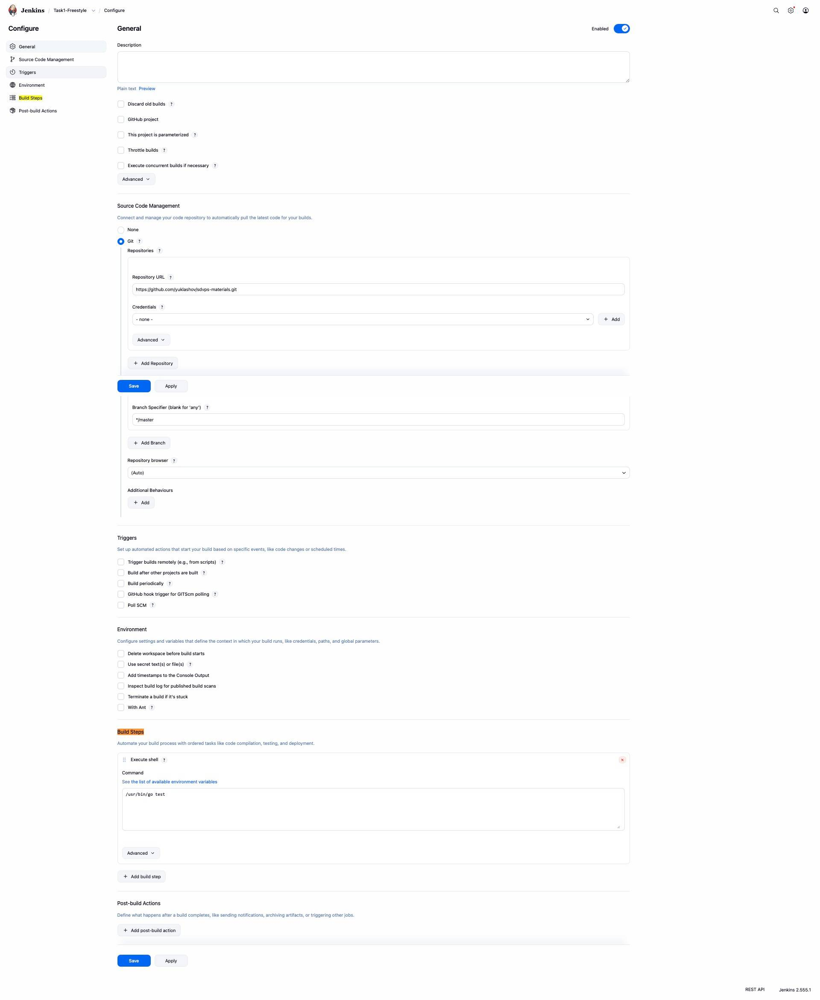
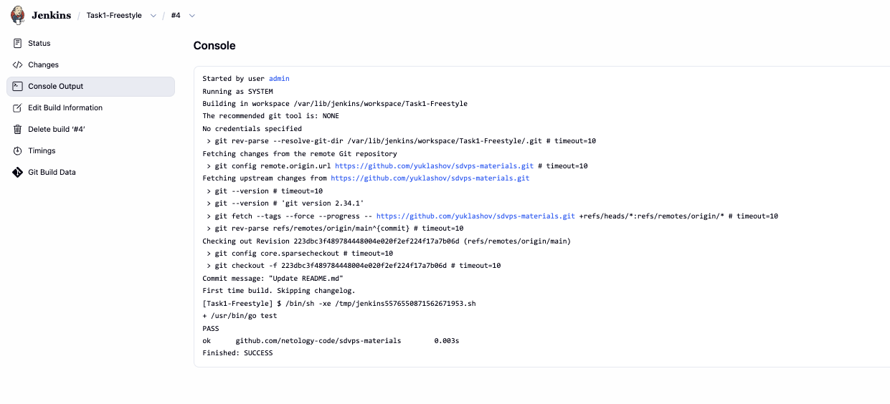
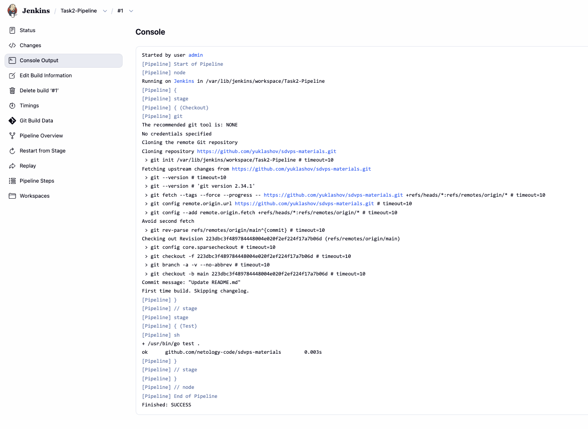
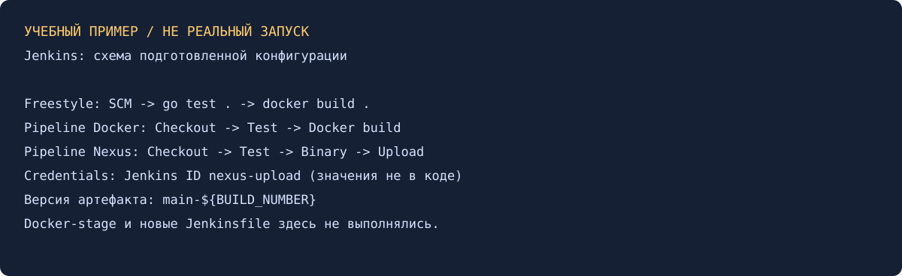
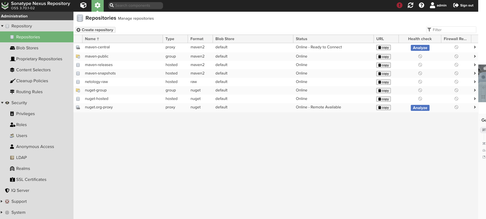
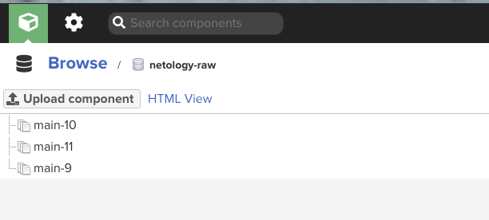

# Что такое DevOps. CI/CD — Александр Юклашов

Выполнено самостоятельно 27 октября 2026 в согласованном локальном режиме. Старый Jenkins/Nexus переиспользован, недостающий код подготовлен; новый стенд и Docker/Go-сборки не запускались.

## 1. Freestyle

Исторически Jenkins брал код из форка `yuklashov/sdvps-materials` и выполнял `go test .`. Снимки подтверждают настройку и успешные тесты:

Docker-сборки на старых кадрах нет. [src/freestyle.sh](src/freestyle.sh) дополняет последовательность командой `docker build`. В [src/app](src/app/main.go) сохранены существующие исходники, тест и Dockerfile из форка. Dockerfile с Go 1.16 — исторический учебный вариант, не рекомендация для новой рабочей системы. Для реального запуска выбирать поддерживаемый Go из официального источника и закреплять образы; сейчас ничего не устанавливалось.

Настройки для повторения: Freestyle → Git SCM → собственный репозиторий/ветка → Execute shell `bash src/freestyle.sh`. На агенте нужны Go и Docker с разрешённым доступом к daemon. Jenkins устанавливается отдельно, не контейнером.

## 2. Declarative Pipeline

[src/Jenkinsfile.docker](src/Jenkinsfile.docker): checkout → тесты → Docker build. Job: Pipeline → Pipeline script from SCM → Git → путь `src/Jenkinsfile.docker` относительно папки решения. Если решение хранится в общем Homework, указать полный путь `8-02-hw/src/Jenkinsfile.docker`, а checkout/dir привязать к `8-02-hw`; файлы примера рассчитаны на корень отдельного учебного проекта.

Кадр подтверждает прежний Pipeline с тестами, а не новый Docker-stage. Ожидаемая структура показана отдельно:

## 3. Nexus

В архиве создан raw-hosted `netology-raw`, собран Go-бинарник и загружен с HTTP 201. Новый [src/Jenkinsfile.nexus](src/Jenkinsfile.nexus) заменяет Docker-stage на `CGO_ENABLED=0 GOOS=linux GOARCH=amd64 go build` и загрузку через curl. URL `nexus.example.test` — пример; нужна реальная HTTPS-точка с доверенным сертификатом. Учётная запись хранится в Jenkins Credentials под ID `nexus-upload`, права — только на нужное хранилище. Она попадает в защищённый временный netrc, удаляемый после шага; секреты не в Jenkinsfile и не в командной строке curl.

Старый кадр 5 с учётными данными исключён из текущего README. Он не редактировался и не публиковался заново. Полный исходный Pipeline отсутствует: новые файлы — восстановленный учебный вариант, не экспорт старой настройки.

## 4*. Версионирование

Имя `main-${BUILD_NUMBER}` сохраняет разные запуски. В одном Jenkins job номер возрастает; при нескольких job нужен дополнительный префикс job/commit, иначе возможны совпадения.

## Проверка

[Условие](Задание.md), [история](Мануал.md), [локальная проверка](evidence/local-checks.txt). Сверены локальный архив, Google ДЗ/Автоматизация (отдельного документа нет), дерево GitHub и локальный форк. Проверены shell-синтаксис и целостность исходников; Jenkins linter, Go и Docker здесь не запускались. Синтетическая схема не является доказательством выполнения Pipeline.

Источники: [Jenkinsfile](https://www.jenkins.io/doc/book/pipeline/jenkinsfile/), [Declarative syntax](https://www.jenkins.io/doc/book/pipeline/syntax/), [установка Go](https://go.dev/doc/install). Отправка, официальный зачёт и экспертная проверка не заявлены.
