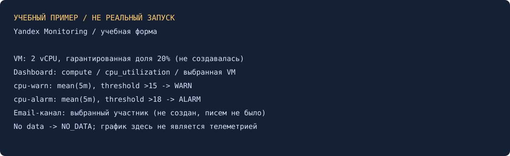

# Обзор систем ИТ-мониторинга — Александр Юклашов

Выполнено самостоятельно 27 октября 2026 в локальном режиме. Переиспользован Terraform из прежней работы; подготовлены дашборд и спецификация двух алертов. VM, облачный мониторинг и отправка email не запускались.

## 1. Дашборд CPU

По условию учебная VM: Debian 11, Intel Ice Lake/standard-v3, 2 vCPU, доля 20%, RAM 1 ГБ, HDD 3 ГБ, прерываемая, агент сбора метрик. Это параметры старого задания; совместимость размера диска с конкретным образом и доступность семейства следует проверять перед новым запуском. Новую VM сейчас создавать не нужно.

В Monitoring: новый дашборд → график → `service=compute`, `name=cpu_utilization`, `resource_id` конкретной VM; период последний час. Показать отдельные ядра или их агрегат и подписать ось %. [src/dashboard.tf](src/dashboard.tf) — исправленный вариант виджета для существующей VM; ресурс VM не создаёт. Секреты не встроены, provider использует окружение для авторизации.

Гипервизорные CPU-метрики Compute уже экспортирует сервис; агент полезен для дополнительных метрик гостевой ОС. Для их отправки нужны соответствующие минимальные права. Старый шаг с monitoring.editor сохранён как условие; фактически IAM в этой работе не менялся.

## 2. Два алерта и email

Предлагаемые настройки для учебной VM с долей CPU 20%:

| Алерт | Ряд | Окно и функция | Условие | Уведомление |
|---|---|---|---|---|
| cpu-warn | cpu_utilization выбранной VM | Среднее 5 минут после max по ядрам | >15 | Статус WARN |
| cpu-alarm | Тот же | То же | >18 | Статус ALARM |

По документации диапазон cpu_utilization зависит от доли vCPU. При 20% нельзя бездумно применять прежние пороги 80/90 к этому ряду. Для 100% CPU можно выбрать 80/90; либо использовать cpu_usage, учитывая другую нормировку. 15/18 выбраны для примера и не навязаны условием.

Создать email-канал для выбранного участника, подтвердить адрес если требуется, выбрать канал в обоих алертах и статусы уведомлений. Проверить тестовую доставку и переходы OK→WARN/ALARM→OK. Отсутствие данных учитывать как NO_DATA, не как нулевую загрузку. Прерывание VM — ожидаемая причина отсутствия ряда, которую следует отличать от нагрузки.

[src/alerts-spec.json](src/alerts-spec.json) содержит значения формы; это не файл API. Старые команды `yc monitoring channel/alert create` из мануала не проверены и не предлагаются к выполнению. В этом сеансе уведомлений не было.

## Проверка и архив

Старый README утверждал создание VM/алертов, но файлов img/dashboard.png, alert_warn.png и alert_alarm.png локально и в доступном дереве GitHub нет. Поэтому исторический запуск по снимкам не подтверждён. Google Диск: в папках учебного архива и поиске smon отчёт не найден. Исходный README сохранён отдельно как история, не как доказательство. Корневые Terraform/state/tfvars не изменялись и не включаются в новый проверенный набор.

[Условие](Задание.md), [команды](scripts/Команды.md), [локальная проверка](evidence/local-checks.txt), [история](Мануал.md). Подготовленная самостоятельная работа локально завершена; официальной отправки/принятия нет.

Источники: [CPU-метрики Compute](https://yandex.cloud/en/docs/compute/metrics), [формат Terraform dashboard](https://github.com/yandex-cloud/terraform-provider-yandex/blob/master/docs/resources/monitoring_dashboard.md), [текущее условие](https://github.com/netology-code/smon-homeworks/blob/main/hw-01-new.md).
