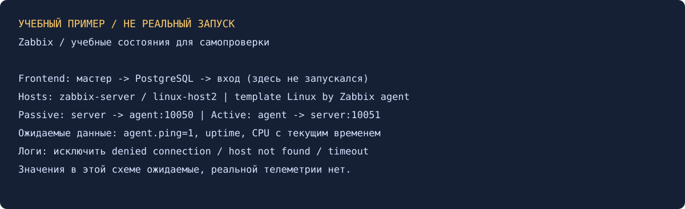

# Система мониторинга Zabbix — Александр Юклашов

Выполнено самостоятельно 27 октября 2026 в согласованном локальном режиме: инструкция сервера/двух агентов, конфигурации и учебный экран. Zabbix/PostgreSQL/VM не устанавливались. Старый отчёт сохранён, подтверждённых снимков в нём не было.

## 1. Server + PostgreSQL + Apache

В старом решении использовались Zabbix 6.0 и Debian 11. Текущее условие просит последнюю версию по официальному конфигуратору; при проверке документация current обозначает 7.4. Для подготовленных команд выбрана Debian 12 с доступным официальным репозиторием 7.4, PostgreSQL из системного репозитория и Apache. Это обновлённый учебный вариант; Debian 11 из старого примера не выдаётся за текущую установку.

[Полная последовательность](scripts/server-reference.sh): подключить официальный репозиторий, поставить PostgreSQL и пакеты server-pgsql/frontend/php-pgsql/apache-conf/sql-scripts/agent, создать роль и БД, импортировать схему, задать пароль в защищённой конфигурации, запустить службы. Путь SQL берётся из `dpkg -L`, чтобы не зависеть от расположения в конкретном пакете.

Открыть frontend `/zabbix` по защищённому каналу, пройти проверку PHP/подключения к PostgreSQL, завершить мастер. Первый вход встроенного администратора и смена исходного пароля выполняются на реальном стенде; пароли не фиксировать в кадре. Успешная страница входа сама по себе не подтверждает работу агентов.

## 2. Два Linux-агента

| Хост | Агент | Server | ServerActive | Интерфейс в Zabbix |
|---|---|---|---|---|
| zabbix-server | На самой машине сервера | 127.0.0.1,192.0.2.10 | 192.0.2.10:10051 | Доступный серверу локальный/частный IP:10050 |
| linux-host2 | На второй Linux-машине | 192.0.2.10 | 192.0.2.10:10051 | 192.0.2.11:10050 |

Все адреса в таблице — примеры из документального диапазона, не действующий стенд. `Server` разрешает пассивные запросы, `ServerActive` задаёт адрес для получения активных проверок; `Hostname` должен точно совпадать с техническим именем хоста для активных элементов. Файлы в [src](src/zabbix_agentd-host2.conf.example).

В Data collection → Hosts (в старом интерфейсе Configuration → Hosts): создать оба хоста, группу Linux servers, Agent-интерфейс и шаблон `Linux by Zabbix agent`. Включить хосты. При выборе active-шаблона смотреть активные элементы и их свежие значения; зелёная доступность пассивного интерфейса сама по себе не доказывает active-обмен.

Самопроверка: `agent.ping=1`, растущий uptime, текущие время/CPU в Latest data **у обоих** хостов. Журнал проверяется на ошибки доступа, несовпадающее имя и недоступность server:10051. Строка «agent started» без данных на сервере ещё не доказывает связь.

## Ограничения и материалы

Windows-агент 3* не выбран. [Условие](Задание.md), [команды](scripts/Команды.md), [история](Мануал.md), [локальные проверки](evidence/local-checks.txt). Shell-синтаксис проверен без исполнения установки; zabbix_get и сквозная проверка здесь не запускались. Отправки/официального зачёта нет.

Поиск прежнего решения: локальные smon-hw-02/учебные материалы, GitHub и Google Диск. Переиспользован текстовый каркас, реальные кадры не найдены. Прежний одинаковый пароль из учебных команд не переносится в новые конфигурации.

Источники: [установка пакетов](https://www.zabbix.com/documentation/current/en/manual/installation/install_from_packages), [официальный репозиторий](https://repo.zabbix.com/zabbix/7.4/release/debian/pool/main/z/zabbix-release/), [параметры агента](https://www.zabbix.com/documentation/current/en/manual/appendix/config/zabbix_agentd).
